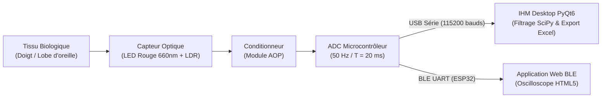

# 🫀 Open-PPG-Monitor — Système d'Acquisition et de Monitoring Cardiaque Temps Réel

[](https://www.python.org/)
[](https://pypi.org/project/PyQt6/)
[](#câblage-matériel)
[](./LICENSE)

**Open-PPG-Monitor** est une plateforme matérielle et logicielle open-source de **photopléthysmographie (PPG)** conçue selon les principes de l'ingénierie biomédicale frugale. Elle permet de capter les variations volumétriques sanguines périphériques à l'aide de composants optoélectroniques standards (**LED rouge + photorésistance LDR + amplificateur opérationnel**), de numériser l'onde pulsatile à **$50\text{ Hz}$** sur **Arduino (10 bits)** ou **ESP32 (12 bits, BLE/USB)**, et d'exécuter un **filtrage numérique de Butterworth en temps réel** pour extraire la fréquence cardiaque (**BPM**) et sa variabilité (**HRV / SDNN**).

> 💡 **Testable sans matériel :** L'application de bureau intègre un **Mode Simulation Physiologique (50 Hz)** générant une onde PPG réaliste (pic systolique, incisure dicrote, dérive respiratoire et bruit capteur) pour tester immédiatement l'interface et les algorithmes.

---

## ✨ Fonctionnalités Principales

- **Acquisition Asynchrone Multithread (`QThread` + `pyserial`) :** Détection automatique Plug & Play des microcontrôleurs (Arduino, ESP32, CH340, CP210x, FTDI), sélection manuelle du port COM ou simulateur interne à $50\text{ Hz}$.
- **Oscilloscope Biomédical Temps Réel (`PyQtGraph`) :** Affichage fluide sur tampon circulaire (*Circular Buffer* de 500 points) avec cadrage vertical dynamique (`AutoRange Y`) éliminant l'offset de lumière ambiante.
- **Traitement Numérique du Signal (`SciPy`) :**
  - Recalcul dynamique de la fréquence d'échantillonnage ($F_e$) sur chaque fenêtre de capture ($10\text{ s}$ à $120\text{ s}$).
  - Filtre passe-bande de **Butterworth d'ordre 3** ($[0{,}5\text{ Hz} \,;\, 4{,}0\text{ Hz}]$, soit $30$ à $240\text{ BPM}$) appliqué à phase nulle (`filtfilt`).
  - Détection topologique adaptative des pics systoliques (`find_peaks`) avec période réfractaire ($0{,}3\text{ s}$) et seuil de proéminence basé sur l'écart-type ($0{,}5\,\sigma$).
  - Extraction du **BPM moyen** et de la **variabilité cardiaque SDNN (ms)**.
- **Suivi Longitudinal & Base de Données Excel (`Pandas` / `OpenPyXL`) :** Enregistrement horodaté automatique dans `Suivi_Patients_BPM.xlsx` avec fenêtre modale de consultation et de suppression des mesures aberrantes.
- **Extension Sans Fil Bluetooth Low Energy (`ESP32` + `Web Bluetooth`) :** Firmware BLE (service UART Nordic NUS, ADC 12 bits) et tableau de bord Web HTML5/Canvas sans installation.

---

## 🗂️ Architecture du Dépôt

```text
open-ppg-monitor/
├── src/                                   # Application de bureau Python (PyQt6 + SciPy)
│   ├── main.py                            # Point d'entrée IHM (Oscilloscope + Contrôles + Historique)
│   ├── lecteur_serie.py                   # Thread Worker d'acquisition USB Série & Simulateur 50 Hz
│   ├── traitement_signal.py               # Pipeline DSP (Butterworth ordre 3, find_peaks, BPM & SDNN)
│   └── enregistreur_excel.py              # Persistance et gestion du classeur Excel des mesures
├── firmware/                              # Code embarqué C++ pour microcontrôleurs
│   ├── arduino_serial_ppg/                # Firmware Arduino (ADC 10 bits, cadencement strict 50 Hz UART)
│   │   └── arduino_serial_ppg.ino
│   └── esp32_ble_ppg/                     # Firmware ESP32 (ADC 12 bits, 50 Hz, dual UART USB + BLE NUS)
│       └── esp32_ble_ppg.ino
├── web_ble/                               # Interface Web Bluetooth (sans installation)
│   └── index.html                         # Client Web BLE avec oscilloscope Canvas temps réel
├── docs/                                  # Documentation d'ingénierie détaillée
│   ├── ARCHITECTURE_MATERIELLE.md         # Physique PPG, conditionnement AOP, quantification 10 vs 12 bits
│   ├── ARCHITECTURE_LOGICIELLE_ET_DSP.md  # Architecture multithread, équations DSP, analyse FAST
│   └── ETUDE_VIABILITE_FRUGALE.md         # Comparatif BOM (LED/LDR vs MAX30102) et feuille de route
├── requirements.txt                       # Dépendances Python
├── .gitignore                             # Exclusion des fichiers temporaires et données locales
└── LICENSE                                # Licence open-source MIT
```

---

## 🔧 Câblage Matériel



| Composant source | Broche | Arduino (Uno / Mega) | ESP32 | Rôle du signal |
| :--- | :--- | :---: | :---: | :--- |
| **Module LDR + AOP** | `VCC` | `5V` | `3.3V` | Alimentation positive du conditionneur |
| **Module LDR + AOP** | `GND` | `GND` | `GND` | Masse commune ($0\text{ V}$) |
| **Module LDR + AOP** | `AO` | `A0` | `GPIO 34` | Sortie analogique du signal PPG |
| **LED d'éclairage** | `Anode (+)` | `5V` ou `3.3V` | `3.3V` | Émission lumineuse continue |
| **LED d'éclairage** | `Cathode (-)` | `GND` (via $220\,\Omega$) | `GND` (via $220\,\Omega$) | Retour de masse avec limitation de courant |

---

## 🚀 Installation et Démarrage Rapide

### 1. Cloner le dépôt et installer les dépendances Python

```bash
git clone https://github.com/LenoirSys/open-ppg-monitor.git
cd open-ppg-monitor

# Création et activation d'un environnement virtuel (recommandé)
python -m venv venv
.\venv\Scripts\Activate.ps1   # Windows PowerShell
# source venv/bin/activate    # Linux / macOS

# Installation des bibliothèques requises
pip install -r requirements.txt
```

### 2. Lancer l'application de bureau (IHM PyQt6)

```bash
python src/main.py
```

- **Avec un Arduino ou ESP32 branché en USB :** Laissez la source sur `🔌 Auto-détection USB` (ou sélectionnez le port `COM` correspondant).
- **Sans matériel connecté :** Sélectionnez `🧪 Mode Simulation (Démo 50 Hz)` dans le menu déroulant en haut à gauche, choisissez une durée ($10\text{ s}$ à $120\text{ s}$) et cliquez sur **🔴 Lancer une mesure**.

### 3. Compiler un exécutable autonome Windows (`.exe`)

Pour déployer l'application sur un poste médical sans installer Python :

```bash
pip install pyinstaller
pyinstaller --noconsole --onefile src/main.py
```

### 4. Utiliser la version Web Bluetooth (ESP32)

1. Téléversez [`firmware/esp32_ble_ppg/esp32_ble_ppg.ino`](./firmware/esp32_ble_ppg/esp32_ble_ppg.ino) sur votre carte ESP32 (bibliothèque `NimBLE-Arduino` requise).
2. Ouvrez [`web_ble/index.html`](./web_ble/index.html) dans **Google Chrome** ou **Microsoft Edge**.
3. Cliquez sur **Connexion BLE (ESP32)** et sélectionnez le périphérique `Biomedical_PPG_ESP32`.

---

## 📚 Documentation Technique Complète

- 🔌 **[Architecture Matérielle & Quantification ADC](./docs/ARCHITECTURE_MATERIELLE.md)** — Principe optique PPG, conditionnement analogique, comparatif de quantification Arduino ($10\text{ bits}$) vs ESP32 ($12\text{ bits}$).
- 🧮 **[Architecture Logicielle & Pipeline DSP](./docs/ARCHITECTURE_LOGICIELLE_ET_DSP.md)** — Gestion multithread `PyQt6`, tampon circulaire, filtrage numérique de Butterworth à phase nulle et détection statistique des pics systoliques.
- 🌍 **[Ingénierie Frugale & Étude de Viabilité](./docs/ETUDE_VIABILITE_FRUGALE.md)** — Analyse comparative des coûts et de la maintenabilité locale face aux capteurs propriétaires (`MAX30102`) et feuille de route en 3 phases.

---

## ⚠️ Avertissement Réglementaire

Ce projet est conçu à des fins **pédagogiques, expérimentales et de recherche en instrumentation biomédicale**. Il ne constitue pas un dispositif médical certifié au sens réglementaire et ne doit pas être utilisé pour établir un diagnostic médical critique sans supervision clinique appropriée.

---

## 📄 Licence

Distribué sous licence **MIT**. Voir le fichier [`LICENSE`](./LICENSE) pour plus d'informations.
