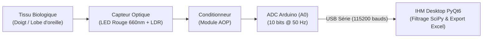

# 🫀 Open-PPG-Monitor — Système d'Acquisition et de Monitoring Cardiaque Temps Réel

[](https://www.python.org/)
[](https://pypi.org/project/PyQt6/)
[](#câblage-matériel)
[](./LICENSE)

**Open-PPG-Monitor** est un système open-source d'instrumentation biomédicale et de **photopléthysmographie (PPG)** conçu selon une approche d'ingénierie frugale. Il permet de capter les variations volumétriques sanguines périphériques à l'aide de composants optoélectroniques standards (**LED rouge + photorésistance LDR + amplificateur opérationnel**), de numériser le signal sur **Arduino** à **$50\text{ Hz}$**, et d'exécuter un **filtrage numérique passe-bande de Butterworth d'ordre 3** en temps réel sous Python pour extraire la fréquence cardiaque (**BPM**).

---

## ✨ Fonctionnalités Principales (V1)

- **Acquisition Asynchrone Multithread (`QThread` + `pyserial`) :** Détection automatique Plug & Play du microcontrôleur Arduino sur les ports COM et reconnexion à chaud sans figer l'interface.
- **Oscilloscope Biomédical Temps Réel (`PyQtGraph`) :** Affichage fluide sur tampon circulaire (*Circular Buffer* de 500 points) avec cadrage vertical dynamique (`AutoRange Y`) éliminant l'offset de lumière ambiante.
- **Traitement Numérique du Signal (`SciPy`) :**
  - Recalcul dynamique de la fréquence d'échantillonnage ($F_e$) sur chaque fenêtre de capture ($10\text{ s}$ à $120\text{ s}$).
  - Filtre passe-bande de **Butterworth d'ordre 3** ($[0{,}5\text{ Hz} \,;\, 4{,}0\text{ Hz}]$, soit $30$ à $240\text{ BPM}$) appliqué à phase nulle (`filtfilt`).
  - Détection topologique adaptative des pics systoliques (`find_peaks`) avec période réfractaire ($0{,}3\text{ s}$) et seuil de proéminence basé sur l'écart-type ($0{,}5\,\sigma$).
- **Suivi Longitudinal & Base de Données Excel (`Pandas` / `OpenPyXL`) :** Enregistrement horodaté automatique dans `Suivi_Patients_BPM.xlsx` avec fenêtre modale de consultation et de suppression des mesures erronées.

---

## 🗂️ Architecture du Dépôt

```text
open-ppg-monitor/
├── src/                                   # Application de bureau Python (PyQt6 + SciPy)
│   ├── main.py                            # Point d'entrée IHM (Oscilloscope + Contrôles + Historique)
│   ├── lecteur_serie.py                   # Thread Worker d'acquisition USB Série (Plug & Play)
│   ├── traitement_signal.py               # Pipeline DSP (Butterworth ordre 3, find_peaks & BPM)
│   └── enregistreur_excel.py              # Persistance et gestion du classeur Excel des mesures
├── firmware/                              # Code embarqué C++ pour microcontrôleur
│   └── arduino_serial_ppg/                # Firmware Arduino (ADC 10 bits, échantillonnage 50 Hz UART)
│       └── arduino_serial_ppg.ino
├── docs/                                  # Documentation d'ingénierie détaillée
│   ├── ARCHITECTURE_MATERIELLE.md         # Physique PPG, conditionnement AOP et câblage Arduino
│   ├── ARCHITECTURE_LOGICIELLE_ET_DSP.md  # Architecture multithread et équations du filtre DSP
│   └── ETUDE_VIABILITE_FRUGALE.md         # Comparatif BOM (LED/LDR vs MAX30102) et feuille de route
├── requirements.txt                       # Dépendances Python
├── .gitignore                             # Exclusion des fichiers temporaires et données locales
└── LICENSE                                # Licence open-source MIT
```

---

## 🔧 Câblage Matériel (Arduino Uno / Mega)



| Composant source | Broche | Destination (Arduino) | Rôle du signal |
| :--- | :---: | :---: | :--- |
| **Module LDR + AOP** | `VCC` | `5V` | Alimentation positive du module et de l'AOP |
| **Module LDR + AOP** | `GND` | `GND` | Masse commune du circuit ($0\text{ V}$ de référence) |
| **Module LDR + AOP** | `AO` | `A0` | Entrée analogique ADC (signal PPG conditionné) |
| **LED d'éclairage** | `Anode (+)` | `5V` ou `3.3V` | Source lumineuse continue traversant le doigt |
| **LED d'éclairage** | `Cathode (-)` | `GND` (via $220\,\Omega$) | Retour de masse avec résistance de protection de $220\,\Omega$ |

---

## 🚀 Installation et Démarrage Rapide

### 1. Cloner le dépôt et installer les dépendances Python

```bash
git clone https://github.com/LenoirSys/open-ppg-monitor.git
cd open-ppg-monitor

# Création et activation d'un environnement virtuel (recommandé)
python -m venv venv
.\venv\Scripts\Activate.ps1   # Windows PowerShell
# source venv/bin/activate    # Linux / macOS

# Installation des bibliothèques requises
pip install -r requirements.txt
```

### 2. Téléverser le firmware Arduino et lancer l'IHM

1. Ouvrez [`firmware/arduino_serial_ppg/arduino_serial_ppg.ino`](./firmware/arduino_serial_ppg/arduino_serial_ppg.ino) dans l'IDE Arduino et téléversez-le sur votre carte Arduino Uno ou Mega.
2. Lancez l'application de supervision :

```bash
python src/main.py
```

---

## 📚 Documentation Technique

- 🔌 **[Architecture Matérielle & Câblage](./docs/ARCHITECTURE_MATERIELLE.md)**
- 🧮 **[Architecture Logicielle & Pipeline DSP](./docs/ARCHITECTURE_LOGICIELLE_ET_DSP.md)**
- 🌍 **[Ingénierie Frugale & Étude de Viabilité](./docs/ETUDE_VIABILITE_FRUGALE.md)**

---

## 📄 Licence

Distribué sous licence **MIT**. Voir le fichier [`LICENSE`](./LICENSE) pour plus d'informations.
