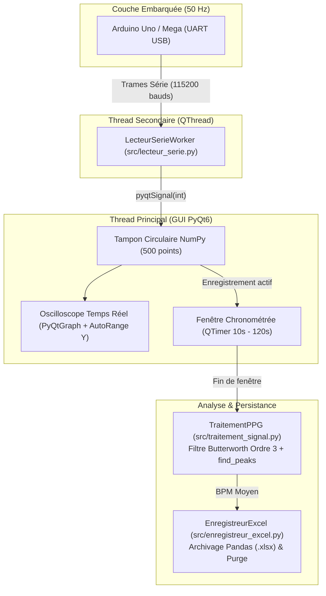

# Architecture Logicielle & Traitement Numérique du Signal (DSP)

## 1. Architecture Multithread Asynchrone

Afin de traiter un flux continu de données biomédicales ($50\text{ Hz}$) sans perte d'échantillons ni gel de l'Interface Homme-Machine (IHM), l'application de bureau ([`src/main.py`](../src/main.py)) repose sur une architecture **Multithread découplée** basée sur `PyQt6` et `PyQtGraph`.

### Rôles des composants logiciels
- **Thread d'Acquisition (`LecteurSerieWorker`) :** S'exécute en arrière-plan dans un `QThread` isolé. Il scanne automatiquement les ports COM, lit et valide chaque trame numérique et émet la valeur via le mécanisme thread-safe `pyqtSignal(int)`.
- **Tampon Circulaire (`Circular Buffer`) :** Un tableau NumPy de taille fixe ($500\text{ échantillons}$, soit $10\text{ s}$ d'affichage glissant à $50\text{ Hz}$) est décalé en mémoire vive sans allocation dynamique coûteuse.
- **Compensation automatique d'offset (`enableAutoRange(axis='y')`) :** La composante continue (DC) induite par la lumière ambiante est automatiquement compensée à l'écran par un cadrage vertical dynamique centré sur l'onde pulsatile (AC).

---

## 2. Pipeline de Traitement Numérique du Signal ([`src/traitement_signal.py`](../src/traitement_signal.py))

Lorsqu'une mesure chronométrée ($10\text{ s}$ à $120\text{ s}$) s'achève, le vecteur d'échantillons bruts est transmis au module mathématique `TraitementPPG.calculer_bpm()` :

### Étape 1 : Estimation dynamique de la fréquence d'échantillonnage ($F_e$)
Pour rendre l'algorithme insensible aux variations de vitesse du port série, la fréquence d'échantillonnage réelle est recalculée sur chaque fenêtre capturée :

$$F_e = \frac{N_{\text{échantillons}}}{T_{\text{mesure}}} \quad \text{et} \quad F_{\text{Nyquist}} = \frac{F_e}{2}$$

### Étape 2 : Filtrage passe-bande de Butterworth à phase nulle
Un **filtre numérique passe-bande de Butterworth d'ordre 3** est synthétisé sur la bande passante physiologique $[0{,}5\text{ Hz} \,;\, 4{,}0\text{ Hz}]$, correspondant à une plage cardiaque de **$30\text{ BPM}$ à $240\text{ BPM}$**.
L'application du filtre de manière bidirectionnelle via `scipy.signal.filtfilt` garantit un **déphasage nul (Zero-Phase Filtering)**, préservant la position temporelle exacte des pics systoliques.

### Étape 3 : Détection topologique adaptative des pics et calcul du BPM
La fonction `scipy.signal.find_peaks` identifie les sommets systoliques selon deux critères :
1. **Période réfractaire minimale ($d_{\min} = 0{,}3\text{ s} \times F_e$) :** Empêche la double détection de l'onde dicrote située sur la pente diastolique.
2. **Proéminence adaptative ($P_{\min} = 0{,}5 \times \sigma_{\text{filtré}}$) :** S'adapte automatiquement à l'amplitude optique propre à chaque patient.

Le rythme cardiaque moyen ($\text{BPM}$) est alors calculé :

$$\text{BPM} = N_{\text{pics}} \times \frac{60}{T_{\text{mesure}}}$$
