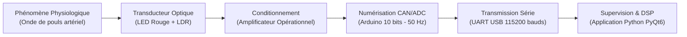

# Architecture Matérielle & Instrumentation Biomédicale

## 1. Principe Physique de la Photopléthysmographie (PPG)

La **photopléthysmographie (PPG)** est une méthode optique non invasive permettant de détecter les variations volumétriques du sang dans le réseau microvasculaire périphérique (doigt ou lobe de l'oreille).

À chaque contraction ventriculaire (**systole**), l'onde de pression sanguine dilate localement les artérioles et capillaires cutanés, augmentant l'absorption lumineuse du tissu. Lors du relâchement cardiaque (**diastole**), le volume sanguin diminue et la transmission lumineuse augmente. Entre ces deux phases, la fermeture de la valve aortique produit une légère inflexion secondaire sur la pente descendante appelée **onde dicrote**.

---

## 2. Chaîne d'Acquisition Instrumentale

Le dispositif suit une architecture de chaîne d'acquisition industrielle découpée en 5 étages fonctionnels :

1. **Émission optique :** Une LED rouge ($\lambda \approx 660\text{ nm}$), polarisée en série avec une résistance de limitation de $220\,\Omega$, génère un flux lumineux constant à travers le tissu biologique.
2. **Transduction photosensible :** Une photorésistance (**LDR**) capte l'intensité lumineuse transmise. Sa résistance électrique varie de manière inversement proportionnelle à l'éclairement reçu.
3. **Étage de conditionnement (AOP) :** Le module LDR intègre un amplificateur opérationnel qui amplifie le signal de faible amplitude et stabilise l'impédance de sortie.
4. **Numérisation (ADC) :** Le microcontrôleur Arduino échantillonne la tension sur `A0` (résolution 10 bits : $0$ à $1023$) à une fréquence stricte de $F_e = 50\text{ Hz}$ (une mesure toutes les $20\text{ ms}$).

---

## 3. Tableau de Câblage (Arduino Uno / Mega)

| Composant source | Broche du composant | Destination (Arduino) | Description / Rôle du signal |
| :--- | :---: | :---: | :--- |
| **Module LDR** | `VCC` | `5V` | Alimentation positive du module et de l'AOP |
| **Module LDR** | `GND` | `GND` | Masse commune du circuit ($0\text{ V}$ de référence) |
| **Module LDR** | `AO` (Analog Out) | `A0` | Entrée du convertisseur analogique-numérique (ADC) |
| **LED d'éclairage** | `Anode (+)` | `5V` ou `3.3V` | Source lumineuse continue de traversée tissulaire |
| **LED d'éclairage** | `Cathode (-)` | `GND` (via $220\,\Omega$) | Retour de masse via une résistance de protection de $220\,\Omega$ |

---

## 4. Étanchéité Optique et Réduction des Artéfacts

La qualité du signal PPG acquis par une photorésistance (LDR) est sensible à deux perturbations physiques majeures :
1. **L'offset optique ambiant :** La lumière extérieure décale le point de fonctionnement de la LDR.
2. **Les artéfacts de mouvement :** Tout glissement ou variation de pression mécanique du doigt modifie brusquement le trajet optique.

Pour stabiliser la mesure, la cellule optique (LED + LDR) doit être maintenue dans une enveloppe opaque exerçant une pression constante mais non occlusive sur la pulpe du doigt.
