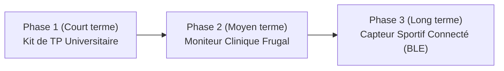

# Étude d'Ingénierie Frugale & Feuille de Route Produit

## 1. Positionnement et Proposition de Valeur

La majorité des moniteurs de fréquence cardiaque et capteurs photopléthysmographiques du marché (oxymètres commerciaux, modules intégrés type `MAX30102`) reposent sur des composants CMS propriétaires. Dans les environnements à ressources limitées ou éloignés des chaînes d'approvisionnement internationales, ces équipements présentent deux vulnérabilités majeures :
1. **Un coût d'acquisition élevé** pour les structures de santé périphériques et les établissements d'enseignement.
2. **Une obsolescence immédiate à la première panne**, faute de pièces de rechange disponibles localement et d'outillage de microsoudure CMS.

### L'approche frugale (LED + LDR + Traitement Numérique Déporté)
Ce projet démontre qu'il est possible de remplacer la complexité matérielle d'un capteur optique propriétaire par **des composants traversants universels** (LED rouge + photorésistance LDR + AOP standard), en compensant l'inertie physique du capteur par un **filtrage numérique avancé (Butterworth ordre 3 à phase nulle)**.

---

## 2. Analyse Comparative : Capteur Frugal (LED + LDR) vs Capteur Dédié (MAX30102)

| Critère d'évaluation | Architecture Frugale (LED + LDR) | Module Spécialisé (MAX30102) |
| :--- | :--- | :--- |
| **Coût de la cellule optique** | **Très faible ($\sim 0{,}02\text{ €}$ / $\sim 10\text{--}50\text{ FCFA}$)** | Élevé ($\sim 2{,}50\text{--}5{,}00\text{ €}$ / $\sim 1\,500\text{--}3\,000\text{ FCFA}$) |
| **Disponibilité des composants** | **Universelle (tout commerce d'électronique local)** | Importation spécifique requise |
| **Maintenabilité / SAV** | **Réparable en $5\text{ min}$ avec un fer à souder standard** | Remplacement complet du module CMS |
| **Robustesse électrique** | Composants traversants tolérants aux fluctuations | Puce intégrée sensible aux décharges ESD et surtensions |
| **Transparence pédagogique** | **Totale (chaîne analogique et numérique observable)** | Boîte noire (registres $\text{I}^2\text{C}$ pré-intégrés) |
| **Qualité du signal brut** | Nécessite un boîtier opaque et un filtre logiciel | Excellente nativement |

---

## 3. Stratégie de Déploiement en Trois Phases

Le même cœur technologique peut être décliné sur trois segments complémentaires selon une feuille de route progressive :

### Phase 1 : Kit Didactique de Travaux Pratiques (Enseignement Supérieur)
- **Cible :** Universités, écoles d'ingénieurs et filières de maintenance biomédicale / électronique / traitement du signal.
- **Configuration :** Carte d'acquisition ouverte connectée en USB à un PC exécutant l'IHM Python open-source.
- **Atout :** Permet aux étudiants d'étudier l'intégralité de la chaîne d'instrumentation (transduction optique, conditionnement AOP, quantification ADC, filtrage de Butterworth sous Python/SciPy).

### Phase 2 : Moniteur de Suivi Frugal pour Dispensaires
- **Cible :** Centres de santé communautaires, dispensaires ruraux et cabinets médicaux à budget contraint.
- **Configuration :** Boîtier ABS/PLA robuste imprimé en 3D, pince doigt/oreille interchangeable à revêtement interne opaque, affichage direct et supervision centralisée sur PC.
- **Atout :** Maintenabilité locale intégrale par n'importe quel technicien disposant d'un fer à souder basique.

### Phase 3 : Capteur Auriculaire Connecté (IoT / Sport & Télémédecine)
- **Cible :** Suivi ambulatoire et sportif via clip de lobe d'oreille.
- **Configuration :** Architecture ESP32 miniaturisée sur batterie Li-Po avec diffusion Bluetooth Low Energy (BLE) vers application Web/Mobile.
- **Atout physiologique :** Le lobe de l'oreille présente une densité capillaire élevée et génère beaucoup moins d'artéfacts de mouvement que le poignet lors d'efforts physiques.

---

## 4. Limites Techniques Identifiées et Pistes d'Amélioration

1. **Temps de réponse de la photorésistance (LDR) :** La constante de temps de recombinaison des porteurs dans le sulfure de cadmium (CdS) atténue l'amplitude du signal au-delà de $150\text{ BPM}$. Pour les applications sportives à très haute fréquence cardiaque, le remplacement direct de la LDR par une **photodiode PIN** ou un **phototransistor** traversant (tout aussi standard et économique) permet d'étendre la bande passante sans modifier l'architecture.
2. **Positionnement réglementaire :** En l'absence d'homologation clinique certifiée, le dispositif est destiné à l'enseignement, au prototypage biomédical et au suivi indicatif non diagnostique.
